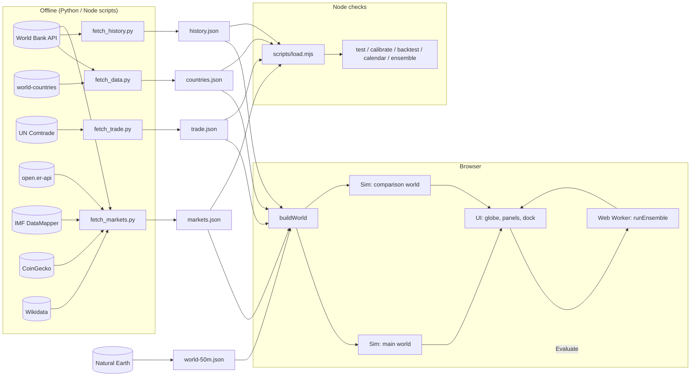
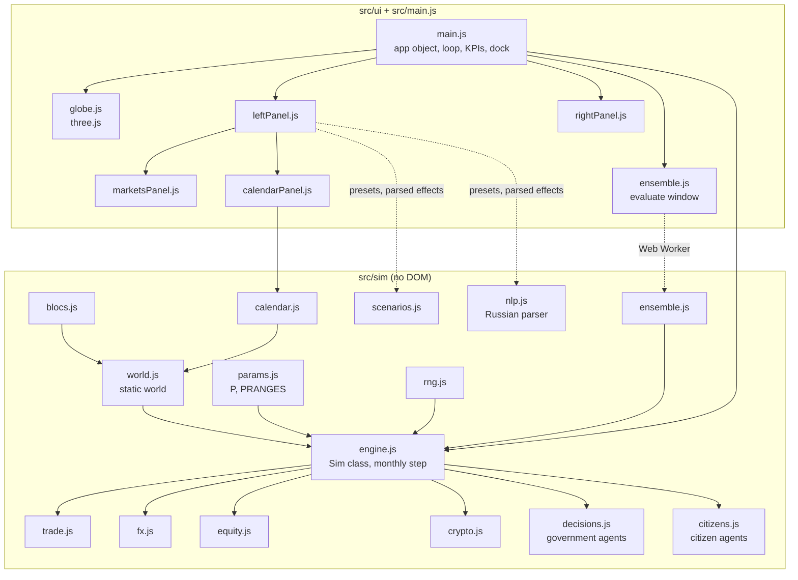
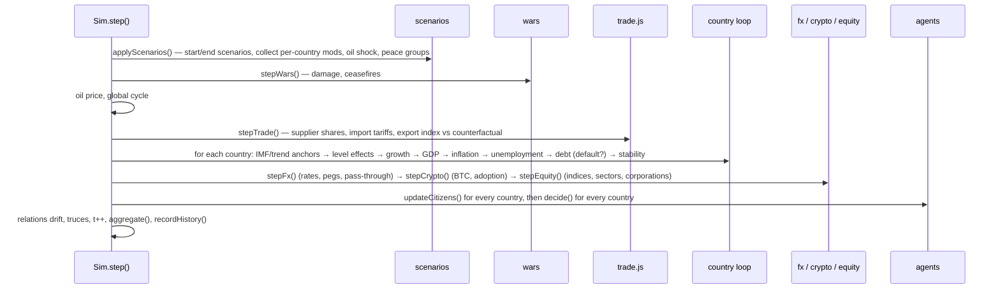
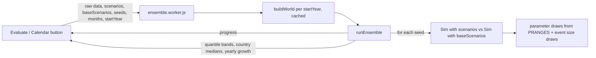

# Architecture

EconSim is a static single-page app (Vite, no backend) plus a set of offline scripts. All simulation code is plain ES modules without DOM access, so the same engine runs on the main thread, in a Web Worker and in Node.

- [System overview](#system-overview)
- [Module map](#module-map)
- [Data flow](#data-flow)
- [The simulation step](#the-simulation-step)
- [State](#state)
- [Determinism and the baseline](#determinism-and-the-baseline)
- [Scenarios and effects](#scenarios-and-effects)
- [Ensemble and the calendar](#ensemble-and-the-calendar)
- [UI runtime](#ui-runtime)
- [Performance](#performance)
- [Design decisions](#design-decisions)

See also [MODEL.md](MODEL.md) (equations and parameters), [DATA.md](DATA.md) (sources and file formats), [DEVELOPMENT.md](DEVELOPMENT.md) (workflow, tests, extending).

## System overview

There are three runtimes for the same code:

| Runtime | Entry | What runs |
|---|---|---|
| Main thread | `src/main.js` | two `Sim` instances stepped by the animation loop; UI rendering |
| Web Worker | `src/sim/ensemble.worker.js` | `runEnsemble`: dozens of `Sim` pairs for the Evaluate and Calendar windows |
| Node | `scripts/*.mjs` | tests, calibration, backtests, calendar check, headless runs |

## Module map

Dependency rules:

- `src/sim` never imports from `src/ui` and never touches the DOM, `window` or `document`.
- `params.js`, `rng.js`, `blocs.js`, `calendar.js` and `scenarios.js` hold data and pure functions; `world.js` builds an immutable world; `engine.js` owns mutable state; the feature modules (`trade`, `fx`, `equity`, `crypto`, `decisions`, `citizens`) read and write the `Sim` instance they receive.
- UI modules talk to each other through the shared `app` object created in `main.js` (`app.sim`, `app.base`, `app.world`, `app.launch`, `app.select`, `app.evaluate`, …), not through imports of each other's internals.

## Data flow

1. **Offline.** Python scripts download open data and write JSON into `public/data/` (see [DATA.md](DATA.md)). Nothing is fetched from third parties at runtime except fonts.
2. **Boot.** `main.js` loads `countries.json`, `world-50m.json`, `trade.json`, `markets.json` and `history.json` in parallel and calls `buildWorld(raw, { trade, markets, history, startYear })`.
3. **World.** `buildWorld` returns an immutable object: country records with derived fields, distance and border matrices, the trade matrix and share matrices, partners and import sources, base relations, alliances, selector groups, currencies, forecasts, companies. For a historical start it first replaces the current state with the actual state at the end of `startYear − 1`.
4. **Simulation.** Two `Sim` objects share the world: the main world and the comparison world ("baseline", or "without the removed events" in calendar mode). The loop steps both once per simulated month.
5. **Views.** The UI reads `sim.S[i]`, `sim.agg`, history arrays and matrices directly and renders the globe colors, KPI strip, panels and charts. Scenario launches go through `app.launch → sim.addScenario`.
6. **Ensembles.** The Evaluate and Calendar windows post the raw datasets and scenario definitions to a worker, which builds its own world (cached per start year) and returns quantile bands.

## The simulation step

`Sim.step()` advances one month. The order matters: shocks are applied first, prices and trade before the country loop, markets after it, agents last.

Effects that depend on other countries (trade, demand spillovers, oil) use values from the previous month or from the start of the step, so the order of countries inside the loop does not matter.

## State

| Object | Where | Contents |
|---|---|---|
| `world` | `world.js` | immutable: `countries[i]` (data + derived), `N`, `idx`, `dist`, `border`, `X`, `xs`, `ms`, `share`, `partners`, `sources`, `base`, `allies`, `groups`, `companies`, `worldForecast`, `startYear` |
| `sim.S[i]` | `engine.js` | per-country dynamic state: GDP, growth (`gc`, `g`), inflation (core, noise, price-level parts), unemployment, rates, debt, stability, sentiment, agent traits, war count, FX (`e`, `q`, regime), stock index (`eq`), crypto share, trade indices, citizens, history arrays |
| matrices on `sim` | `engine.js`, `trade.js` | `N×N` typed arrays: tariffs `T`, sanctions `San`, wars `warMat`, relations `R`, aid memory, current import shares `msCur` |
| globals on `sim` | various | oil, global cycle, risk factor, BTC, sector factors, wars list, scenarios, peace groups, locks (`lockedT`, `lockedSan`), corporations, event log, world history `wh` |

Index `k = i * N + j` addresses country pairs; `N = 197`. History arrays keep the last 900 months.

## Determinism and the baseline

`rng.js` is counter-based: `hash(seed, a, b, slot)` returns the same number for the same inputs, with no hidden state. Every random draw is keyed by what it is about, so the main and comparison worlds draw identical shocks as long as they reach the same decision point, and the difference between them is the effect of the scenario.

Slot ranges (keep new draws out of them):

| Range | Used by |
|---|---|
| `rnd(i, 1..3)`, `gs(i, 1..2)` | growth and inflation noise, default |
| `rnd(i, 10..61)` | government decisions (tariffs, sanctions, aid, war) |
| `rnd(i, 77..79)`, `gauss(i, t, 80..83)` | elections, coups, government change |
| citizens: id `1 000 000 + i·1000 + k`, slots 70–76, 84 | labor market, sentiment, protests, emigration |
| `rnd(·, 91)`, `200+`, `300+`, `400+ (war id % 97)` | war intensity, allies joining, war endings |
| `rnd(i, 120)`, `gauss(i, t, 121)` | peg breaks, FX noise |
| `gauss(i, t, 130)`, `rnd(j, 140+)` | stock index noise, relocation choice |
| country ids `9994..9999` | sector factors, global risk factor, BTC, euro area FX, global cycle, oil |
| `hash(seed, i, 7777, 1..4)` | agent traits at reset |
| `hash/gauss(seed, 777/778, …)` | ensemble parameter and magnitude draws |

Same seed + same scenarios ⇒ identical run (tested in `npm test`). The UI starts each world with a random seed; Node scripts use fixed seeds.

## Scenarios and effects

A scenario is `{ title, duration, start, effects[] }`. Effects are data, interpreted by the engine:

| Kind | Applied | Notes |
|---|---|---|
| `shock` `{targets, var, value, scale?, at?, len?}` | every month while active (`level`/`pop`/`debt`/`equity` once) | vars: growth, infl, unemp, stab, sent, mil, fiscal, level, pop, debt, fx, equity, cryptoBan |
| `oil` `{value, at?, len?}` | while active | added to the oil price target |
| `tariff` / `sanction` `{from, to, value}` | at start, reverted at end | stored as per-scenario claims; the maximum active claim wins |
| `war` `{a, b, noAllies?}` | at start | ends when the scenario ends (or naturally if open-ended) |
| `relation` `{a, b, value}` | at start | one-off shift |
| `peace` `{a}` | at start + while active | ends wars inside the group, lifts mutual barriers, blocks new wars |
| `crypto`, `sector`, `company`, `relocate` | at start | one-off jumps / agent actions |

Targets are selectors resolved by `world.groups`: `all`, `iso:XXX`, `region:…`, `subregion:…`, `bloc:…`, `income:…`, `oilExp`, `energyImp`. `duration: 0` means open-ended. `at`/`len` give phases inside a scenario (e.g. a crash followed by a rebound).

Scenarios come from four producers that all emit the same format: presets (`scenarios.js`), the builder, the Russian parser (`nlp.js`) and the calendar (`calendar.js`).

## Ensemble and the calendar

`runEnsemble` mutates the shared parameter object `P` per seed and restores it in `finally`; this is safe because a worker (or a Node process) runs one ensemble at a time. The same event receives the same size draw in both worlds (keyed by its title), so the difference isolates the event rather than the noise in its size.

Calendar mode is the same machinery with a historical world: `buildWorld({ startYear })` loads the actual state at the end of the previous year; the main world gets every calendar event after the start, the comparison world all but the removed ones.

## UI runtime

- **Loop.** `requestAnimationFrame` accumulates `dt × speed` and performs up to 4 monthly steps per frame. Rendering is throttled: map colors and HUD every 250 ms, slower panels (scenarios, markets, impact) every 800 ms.
- **Globe** (`globe.js`). Country polygons from Natural Earth are painted once into a 4096×2048 canvas texture; recoloring repaints the canvas. A hidden 2048×1024 id map is used for mouse picking. Dependencies are painted with their sovereign's color, unmodeled areas hatched. Arcs and markers show wars, sanctions and the selected country's partners.
- **Panels.** Left rail (Scenarios, Prompt, Builder, Calendar, Markets, Data), right inspector (world or country, tabbed), bottom dock (time controls, timeline, news), map key. Each panel exposes a `refresh*` function on `app` that the loop calls.
- **Modes.** Normal (start 2026, comparison = baseline without scenarios) and calendar (historical start, comparison = without the removed events). `app.setStartYear` rebuilds the world; `app.swapWorlds` swaps which world the globe shows.

## Performance

| Quantity | Value |
|---|---|
| One `Sim.step()` (197 countries, all modules) | ~1.8 ms (Node, Apple Silicon) |
| Two worlds × 10 years | ~0.45 s |
| Evaluate: 20 seeds × 60 months × 2 worlds | ~5–10 s in the worker |
| Calendar: 20 seeds × 13 years × 2 worlds | ~12–35 s in the worker |
| `N×N` matrices | 39 k cells each, typed arrays |

Hot spots: the relations loop (`N²/2`), the trade loop (`N × 45` sources; `pow` is skipped for pairs without barriers) and citizens (up to 100 agents per country).

## Design decisions

| Decision | Why |
|---|---|
| No backend; data baked into JSON | open data changes slowly; the app works from any static host and offline; third-party APIs (Comtrade, CoinGecko) are rate-limited |
| Counter-based RNG instead of a stateful generator | identical shocks in both worlds regardless of call order, so scenario effects are not polluted by noise; runs are reproducible |
| Two parallel worlds instead of "run, then rerun without" | the comparison is live on the globe and in every metric while the simulation plays |
| Engine free of DOM | the same code runs in the worker and in Node tests/calibration |
| Effects as data | presets, the builder, the parser and the calendar all produce the same format; ensembles can rescale magnitudes generically |
| Monthly step with smoothed states | annual data (World Bank) calibrates moments; months make animation and event timing natural |
| Literature parameters with ranges | many effects cannot be estimated from the available data; ranges make that uncertainty visible in Evaluate instead of hiding it |
| Russian UI, English code | the product audience is Russian-speaking; the code base and docs are for any developer |
