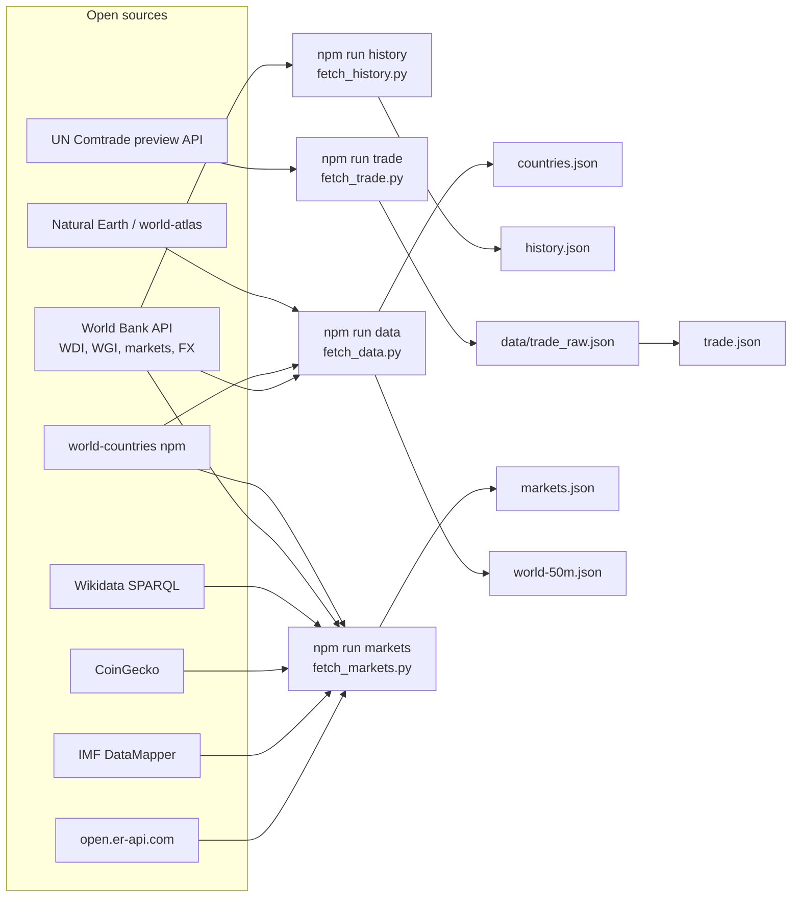

# Data

All datasets are open, fetched by offline scripts and committed as JSON, so the app needs no backend and makes no third-party calls at runtime.

## Pipeline



| Command | Script | Writes | Time | Notes |
|---|---|---|---|---|
| `npm run data` | `fetch_data.py` | `countries.json`, `world-50m.json` | ~1 min | `--add <cca3>` adds/updates one country without refetching (used for Kosovo: `--add UNK`) |
| `npm run history` | `fetch_history.py` | `history.json` | ~1 min | 1995–2024; historical starts need the year before the start |
| `npm run trade` | `fetch_trade.py` | `data/trade_raw.json`, `trade.json` | ~2 h | the public API takes ~20 s per request and rate-limits; the script stops on HTTP 403/429, saves progress and resumes on the next run (including earlier empty answers); `--build` only rebuilds `trade.json` from the cache |
| `npm run markets` | `fetch_markets.py` | `markets.json` | ~1 min | currencies, FX, IMF forecasts, crypto, stock markets, companies |

After refreshing data, run `npm test` and `npm run calibrate` (see [DEVELOPMENT.md](DEVELOPMENT.md)).

## Country coverage

197 economies: 194 sovereign states plus Taiwan, Palestine and Kosovo (partially recognized, but separate economies in World Bank / IMF data). Kosovo has the temporary code `UNK` and no numeric code in world-countries; it is mapped to the World Bank code `XKX`.

On the globe, Natural Earth polygons without their own country are colored like the state the World Bank assigns them to (Greenland → Denmark, Puerto Rico → USA, Hong Kong → China, Somaliland → Somalia, Northern Cyprus → Cyprus, …). Antarctica, Western Sahara and the Siachen Glacier are hatched as not modeled. Tuvalu has no polygon and is drawn as a dot.

## Files

### `countries.json` — array of 197 records

| Field | Meaning | Source |
|---|---|---|
| `iso3`, `iso2`, `num`, `name`, `nameRu` | codes and names (`num` empty for Kosovo) | world-countries |
| `region`, `subregion`, `lat`, `lon`, `area`, `borders`, `landlocked`, `unMember` | geography | world-countries |
| `income`, `capital`, `capLat`, `capLon` | income group and capital | World Bank metadata |
| `gdp`, `gdpPc`, `pop`, `popGrowth`, `growth`, `infl`, `unemp`, `debt` | macro, latest value | WDI |
| `exports`, `imports`, `fdi`, `fuelExp`, `energyImp` | openness, fuel exports, energy dependence | WDI |
| `mil`, `lifeExp`, `gini`, `urban`, `tertiary`, `internet` | military spending, society | WDI |
| `wgiVA`, `wgiPV`, `wgiGE`, `wgiCC` | voice & accountability, political stability, government effectiveness, control of corruption | WGI |
| `years` | year of each value (`manual` for hand-filled values) | — |
| `imputed` | fields filled with the regional median | — |

Taiwan and North Korea get hand-filled estimates (`MANUAL` in `fetch_data.py`).

### `history.json` — `{ ISO3: { indicator: { year: value } }, _WLD: {...} }`

Indicators per country, 1995–2024: `growth` (NY.GDP.MKTP.KD.ZG), `infl` (FP.CPI.TOTL.ZG), `unemp` (SL.UEM.TOTL.ZS), `gdp` (NY.GDP.MKTP.CD), `pop` (SP.POP.TOTL), `fx` (PA.NUS.FCRF), `debt` (GC.DOD.TOTL.GD.ZS). `_WLD`: world growth and inflation. Used by calibration, historical starts and the actual-data overlays.

The World Bank "World" inflation series uses its own aggregation; when comparing with the model, `calendar-check.mjs` aggregates country CPI inflation by GDP weights, the way the model does.

### `trade.json`

```json
{
  "source": "UN Comtrade (HS TOTAL, goods), importer-reported flows with exporter mirror fallback",
  "years": ["2022", "2023"], "unit": "USD mn",
  "reporters": [...], "reportersM": [...], "reportersX": [...],
  "exports": { "<exporter ISO3>": { "<importer ISO3>": <USD mn>, ... }, ... }
}
```

`exports[i][j]` is goods exports from `i` to `j`. A flow is taken from the importer's report (CIF converted to FOB by ÷1.06) and otherwise from the exporter's report. At build time (`world.js`) pairs reported by neither side get a gravity estimate scaled to the exporter's observed flows, and every row is scaled to World Bank total exports (goods + services). Taiwan is Comtrade's "Other Asia, nes" (code 490).

The committed snapshot has 124 import and 123 export reporters, the US and UK included: the public API rate-limits, and Russia, Mexico, Turkey, Vietnam and a few others are still missing (Taiwan does not report). Their flows are covered from their partners' reports and gravity; `npm run trade` completes the set when the quota allows.

### `markets.json`

| Key | Contents | Source |
|---|---|---|
| `asOf` | timestamp of the FX snapshot | open.er-api.com |
| `currencies[ISO3]` | `code`, `name`, `symbol`, `regime` (`float`, `peg`, `union`, `dollarized`, `anchor`), `anchor`, `rateUSD`, `fxVol` (σ of annual log change 2008–2024), `fxDrift` | world-countries, open.er-api.com, World Bank PA.NUS.FCRF; regimes by hand after IMF AREAER |
| `forecast[ISO3]` | `growth`, `infl`, `unemp` by year 2026–2031 | IMF WEO DataMapper |
| `worldForecast` | IMF world growth (PPP weights); the model re-weights country forecasts by GDP at market rates | IMF WEO DataMapper |
| `crypto` | BTC and ETH price and market cap, BTC annual volatility from a year of daily prices | CoinGecko |
| `equity[ISO3]` | `mcap`, `mcapGdp`, `vol` (σ of annual log changes of S&P country indices, USD) | World Bank CM.MKT.LCAP, CM.MKT.INDX.ZG; Taiwan estimated (not in WB) |
| `companies[]` | `name`, `iso`, `sector`, `foreign` (foreign revenue share), `mcap`, `mcapSource`, optional `prod` (production country and cost share) | curated list; market cap from Wikidata P2226 when dated 2024+ and within 3× of the estimate |

### `sources.json`

Catalog shown in the Data tab: every source with what it provides and whether it is used.

## Data quality notes

- Missing World Bank values are filled with regional medians (`imputed`); five micro-states have many imputed fields.
- Wikidata market caps are noisy (wrong units, stale dates, exchanges listed as companies), hence the plausibility filter; most companies keep the curated estimate.
- Stooq index history is behind a bot check and is not used; World Bank annual index changes are used instead.
- Licenses: World Bank data is CC BY 4.0, Natural Earth is public domain; check the terms of IMF, UN Comtrade, CoinGecko and the other providers before reuse.
